# Johnny 5 body — v37 (jointed: 32 body joints)

Everything below the neck, rebuilt from the front, three-quarter, side and
gripper photographs. **The head and neck are untouched**: the text of
`johnny5_head.urdf` up to the body block is byte-for-byte identical to the
original, every original link and joint is present and unchanged, and the
embedded `servo_animator_calibration` block is preserved.

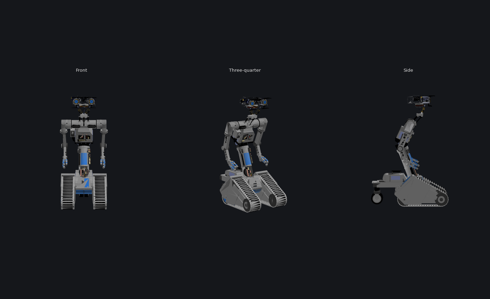
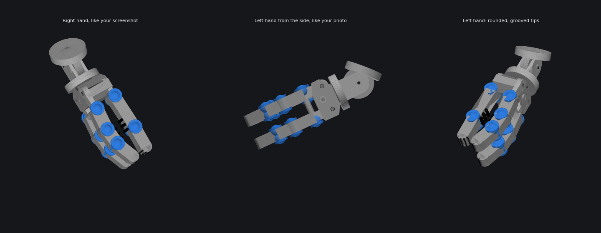
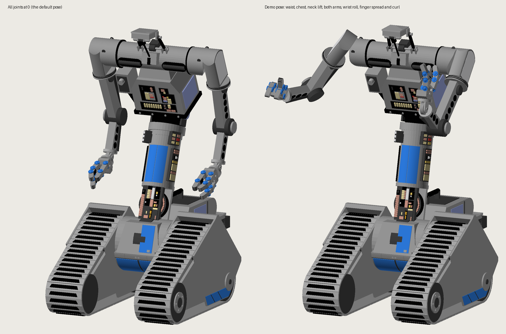
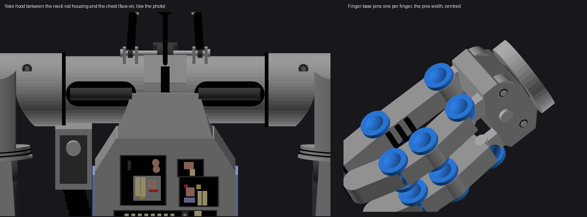
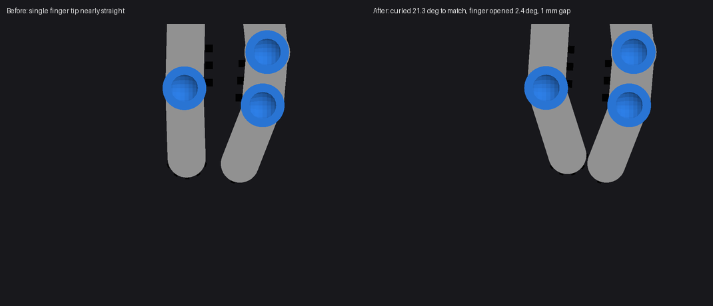
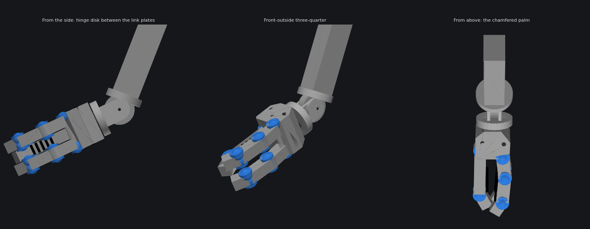
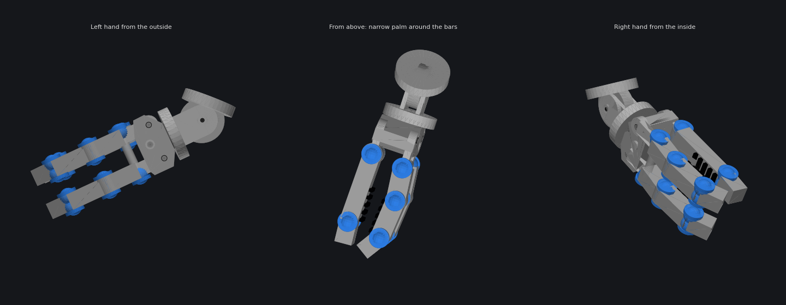
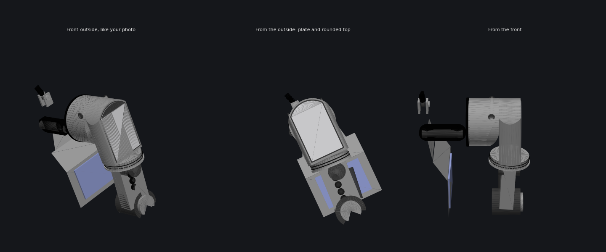
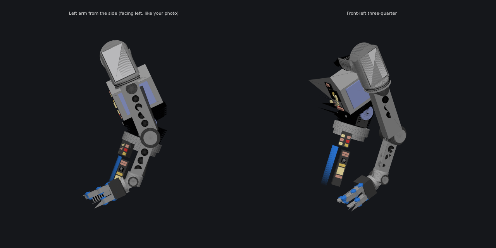
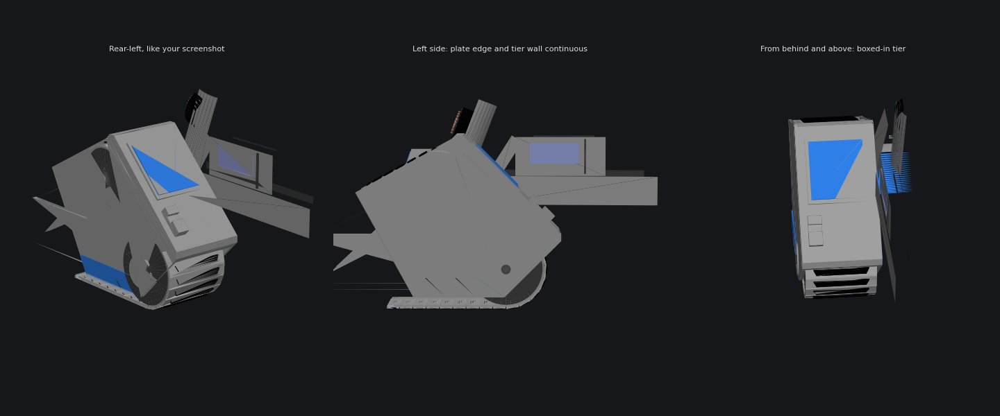
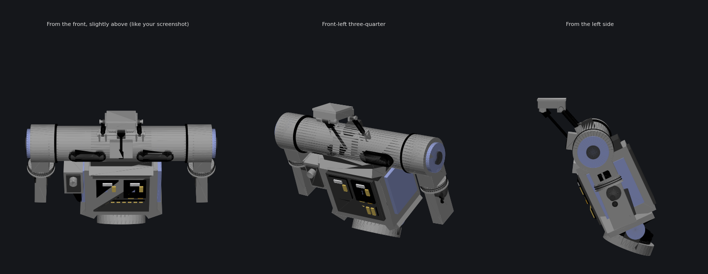
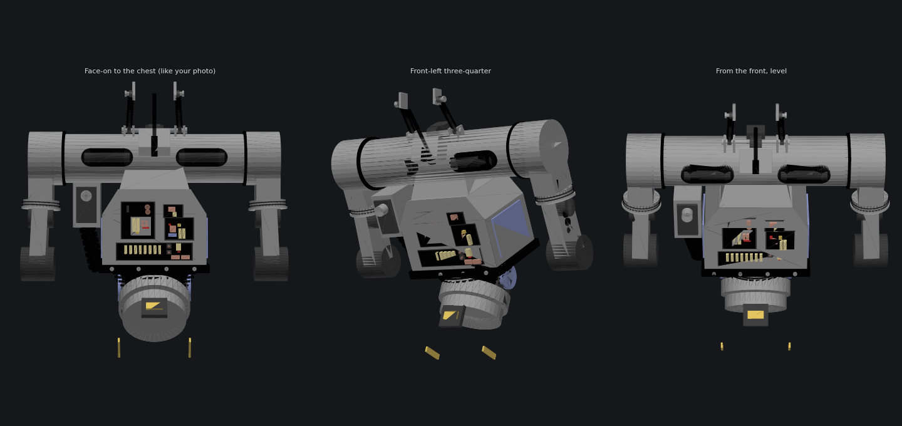
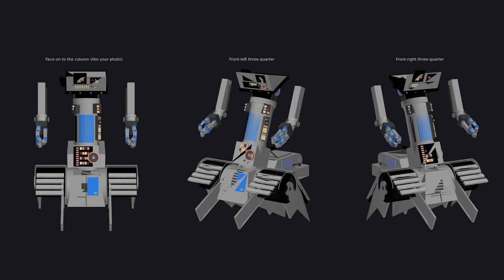
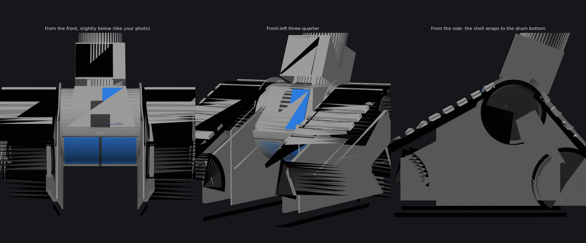
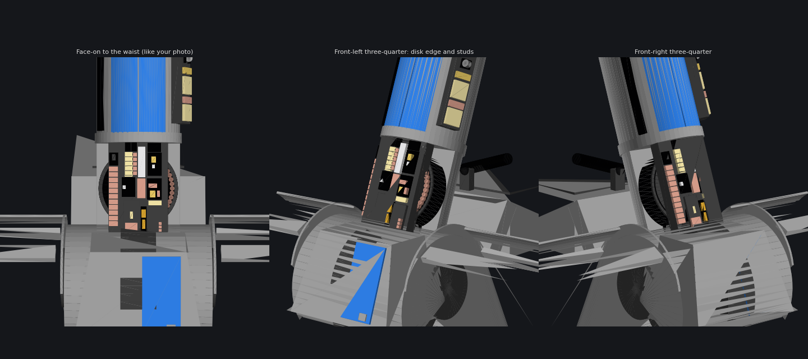
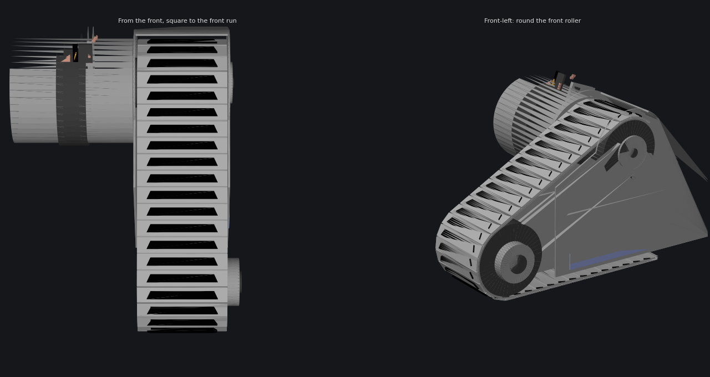
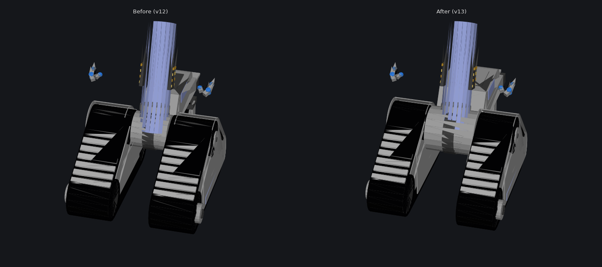
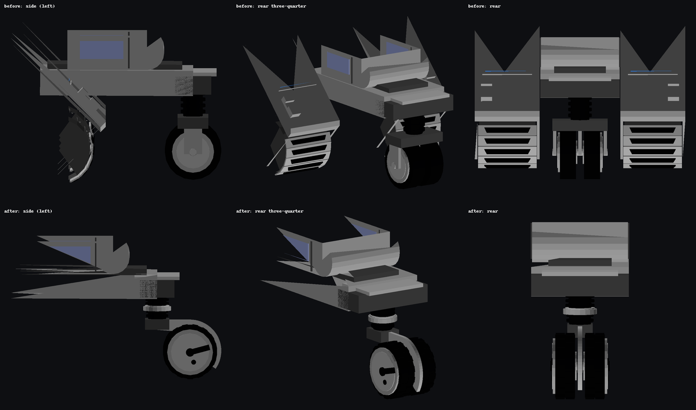

## Circular face clearance

The active URDF and `build_robot.py` give the rounded finger/thumb tips, finger/thumb
knuckles, and rounded wrist link plates 0.5 mm of extra axial length at each end
(1 mm total cylinder length). This separates their circular faces from the adjoining
flat surfaces and avoids coplanar depth flicker when the model moves. The change is
visual geometry only: joint pivots, motion limits, cylinder radii, and materials
are unchanged. Both hands receive the same clearance.

## Files

The editor loads `Models/johnny5_head.urdf` by name — rename to switch.

| File | Contents |
| --- | --- |
| `johnny5_head.urdf` | **Head + full body v37** (active) — 817 links |
| `legacy/build_robot_v36.py` | Generator for body v36 (no waist swivel) |
| `legacy/build_robot_v35.py` | Generator for body v35 (rear housing on the caster arm) |
| `johnny5_head.body-v33.urdf` | Head + body v33 (single finger's tip nearly straight) |
| `johnny5_head.body-v32.urdf` | Head + body v32 (single finger base axle, no yoke hood) — 731 links |
| `johnny5_head.body-v31.urdf` | Head + body v31 (all parts fixed) — 699 links |
| `johnny5_head.body-v30.urdf` | Head + body v30 (bends further out, square tips) — 691 links |
| `johnny5_head.body-v29.urdf` | Head + body v29 (68 mm palm, 8 x 4 mm bars) — 691 links |
| `johnny5_head.body-v28.urdf` | Head + body v28 (bars to the outer base pads) — 691 links |
| `johnny5_head.body-v27.urdf` | Head + body v27 (three axles, bars to the knuckles) — 695 links |
| `johnny5_head.body-v26.urdf` | Head + body v26 (palm rolled with the fingers) — 671 links |
| `johnny5_head.body-v25.urdf` | Head + body v25 (box palms, wide hinge) — 655 links |
| `johnny5_head.body-v24.urdf` | Head + body v24 (short upper arm) — 649 links |
| `johnny5_head.body-v23.urdf` | Head + body v23 (stepped housing on a base block) — 649 links |
| `johnny5_head.body-v22.urdf` | Head + body v22 (45 deg shroud top, thin plates) — 653 links |
| `johnny5_head.body-v21.urdf` | Head + body v21 (box shoulder brackets) — 655 links |
| `johnny5_head.body-v20.urdf` | Head + body v20 (curved shroud wrap) — 645 links |
| `johnny5_head.body-v19.urdf` | Head + body v19 (plain front hubs) |
| `johnny5_head.body-v18.urdf` | Head + body v18 (riveted pads, wide edge up) |
| `johnny5_head.body-v17.urdf` | Head + body v17 (plain black belts) — 669 links |
| `johnny5_head.body-v16.urdf` | Head + body v16 (wide electronics block) — 629 links |
| `johnny5_head.body-v15.urdf` | Head + body v15 (straight pelvis front) |
| `johnny5_head.body-v14.urdf` | Head + body v14 (plain blue column) |
| `johnny5_head.body-v13.urdf` | Head + body v13 (hub further out, no second pivot) |
| `johnny5_head.body-v12.urdf` | Head + body v12 (narrow drum, 200 mm belts) |
| `johnny5_head.body-v11.urdf` | Head + body v11 (plain box chest) |
| `johnny5_head.body-v10.urdf` | Head + body v10 (box yoke) |
| `johnny5_head.body-v9.urdf` | Head + body v9 (open tracks) |
| `johnny5_head.body-v8.urdf` | Head + body v8 (no shoulder swivel) |
| `johnny5_head.body-v7.urdf` | Head + body v7 (single wrist swivel) |
| `johnny5_head.body-v6.urdf` | Head + body v6 (posed, simple grippers) |
| `johnny5_head.body-v5.urdf` | Head + body v5 (upright, with neck linkage) |
| `johnny5_head.body-v4.urdf` | Head + body v4 (no neck linkage) |
| `johnny5_head.body-v3.urdf` | Head + body v3 (original sprocket position, with laser) |
| `johnny5_head.body-v2.urdf` | Head + body v2 (flat tracks) |
| `johnny5_head.torso-only.urdf` | Head + upper torso only |
| `johnny5_head.no-torso.urdf` | Pristine original, head alone |
| `johnny5_head.with-backdrop.urdf` | Head + body + the stage set (see `Backdrop/README.md`) |
| `johnny5_backdrop_only.urdf` | The stage set on its own |
| `johnny5_body_only.urdf` | Body v15 alone — needs only the meshes in `Meshes/Body` |
| `johnny5_torso_only.urdf` | Upper torso alone, no meshes |

## What changed in v37 — waist swivel and its chain drive

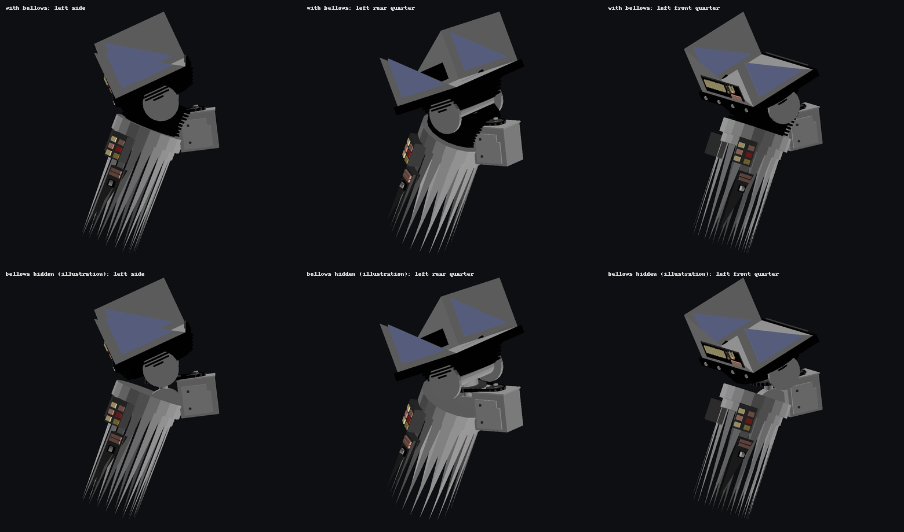

From the side photographs, scaled with the column's 136 mm width: just below the
body hinge pin, the upper body turns on a swivel.

- **Swivel axis**: leans 7° forward of vertical in the posed robot. It runs
  93 mm from the centre of the waist drive support up to the hinge pin, which
  stays where it was (on the column axis), so the upper body has not moved.
- **Hinge pin caps**: the large rounded grey caps, 40 mm in radius. The hinge
  cheeks were removed: nothing needed them.
- **Swivel sprocket**: 24 teeth, on the axis 30 mm below the pin, between the
  caps. It turns with the upper body on a hub under the pin and a shaft down
  to the support.
- **Waist drive support**: a D-shaped lug square to the column, flat side
  down and arc up, on the back of the column top. It is centred on the foot of
  the swivel axis, with a bolt head on each face.
- **Drive box**: on the support, fixed to the column, 31–115 mm behind the
  axis and 83 mm tall. It has a lid, and a raised cover with a stepped upper
  rear corner and screws on each side. The motor's 10-tooth sprocket, with its
  shaft and nut, sits on its top, 75 mm behind the swivel sprocket and level
  with it.
- **Drive belt**: a plain 7 × 3 mm band round both sprockets, 272 triangles.
  The swivel isn't animated, so the belt replaces the earlier link-by-link
  chain. The lower bellows was kept, so the sprocket and the front of the belt
  sit inside it.
- **New joint `WaistSwivel`** (revolute, ±1.57 rad, effort 40, velocity 1): the
  swivel axis, between WaistLean and ChestTilt. Positive turns the upper body
  anticlockwise seen from above.
  - Turning with it: the swivel sprocket, hub and shaft, and the hinge (pin
    and caps), plus everything above, because
    ChestTilt now hangs from it.
  - Staying put: the support, the drive box, the motor sprocket, the belt, the
    lower bellows and the column.
  - At 0 every part is exactly where it was. The J5 Animation Editor has no
    control for it yet.
- **Fall-apart clip**: not updated for the swivel yet.
- Checks: `--waist-swivel` (13 assertions).

## What changed in v36 — rear housing folded into the caster arm

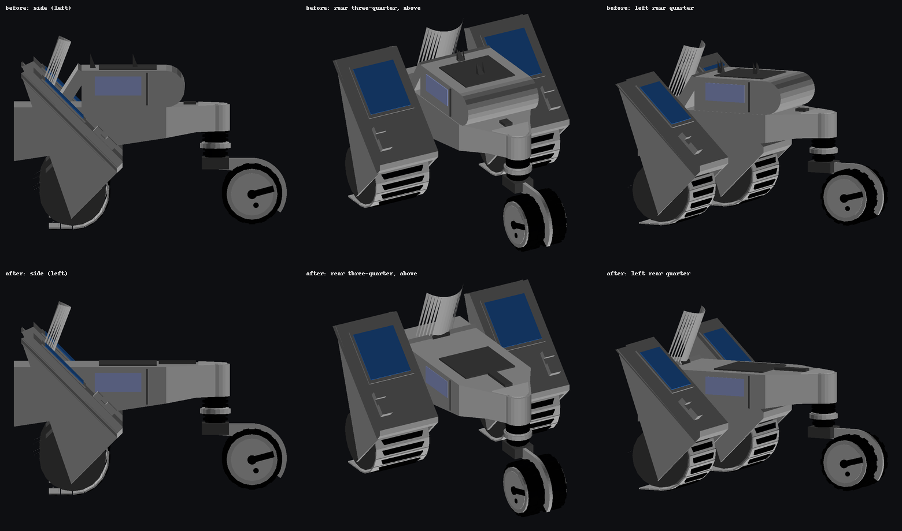

- **Removed**: the rear housing body, its sloped front, its rounded tail, the
  grab handle and both handle posts.
- **Taller caster arm**: the arm's flat top (and the caster head's, which
  shares the triangle) now sits level with the point where the waist column's
  rear face meets the pelvis drum at the back, about 16 mm higher than before.
  The underside is unchanged.
- **Panels on the arm**: the housing's dark top panel now lies on the arm's
  top. Its blue-grey side panels and dark panel lines sit on the arm's sides,
  1 mm proud, since the arm is only 1.5 mm clear of the track shrouds. The
  spine along the taper now starts just behind the top panel.
- Every part that stayed keeps its link frame, so the fall-apart clip was not
  re-baked. The six removed links were pruned from
  `Meshes/Body/FallApart/fall_apart.json`; every other piece's trajectory is
  unchanged.

## What changed in v35 — trailing rear caster

From the side and rear photographs of the rear caster:

- **Offset swivel.** The wheels now trail 95 mm behind the swivel axis
  (`CASTER_TRAIL`), as on a real castor. The swivel itself did not move: the
  axis is still at the end of the caster arm, so the wheels sit 95 mm further
  back than in v34.
- **Swivel stack.** The single bellows is now two bellows sections split by a
  grey collar, on a dark swivel block (`caster_yoke`, whose origin is the
  swivel axis).
- **Trailing plate.** A single light metal plate between the twin wheels
  (`caster_fork_arm`, a generated STL) runs back from the swivel block into a
  band that follows the tyre from its top round to the lower rear, standing
  12 mm proud of the tread. A web and a boss carry the axle. The three straight
  forks were removed.
- **Wheels.** The tyre body is 3 mm under the full radius, with two staggered
  rows of 16 tread lugs out to it (the knobbly tread in the photographs), so
  the wheels still touch the floor.
- **Hub covers.** A larger grey outer band (66 mm radius), a lighter inner
  face, a black centre boss, a black accent bar from the centre out to the
  band (toward the rear, slightly up, as in the side photograph), and a small
  dark plug below the centre.
- Only `body_caster_*` links changed (checked by regenerating). The editor
  swivels every caster part named `yoke*`, `fork*`, `axle*`, `wheel*` or
  `hub*` about the swivel block's origin, so the plate, wheels, lugs and hub
  detail all turn together; the bellows and collar stay put.
- `Meshes/Body/FallApart/fall_apart.json` was re-baked for the new parts.
- **Triangular arm and head** (from the annotated rear photograph): seen from
  above, the caster arm and caster head form one triangle. It is full width
  under the rear housing back to the housing tail's axis (`CASTER_TAPER_X`),
  then tapers to a 75 mm rounded nose over the swivel (`CASTER_NOSE_W`). The
  top stays flat under the housing. The arm's underside now angles down from
  the head's front edge to the bottom of the pelvis drum. The rib became a
  spine along the taper, and the top plate a cap on the head; all four are
  generated STLs.
- These four parts keep their link frames, so the fall-apart clip was **not**
  re-baked for this step. Their pieces fall along the old trajectories with
  the new shapes.

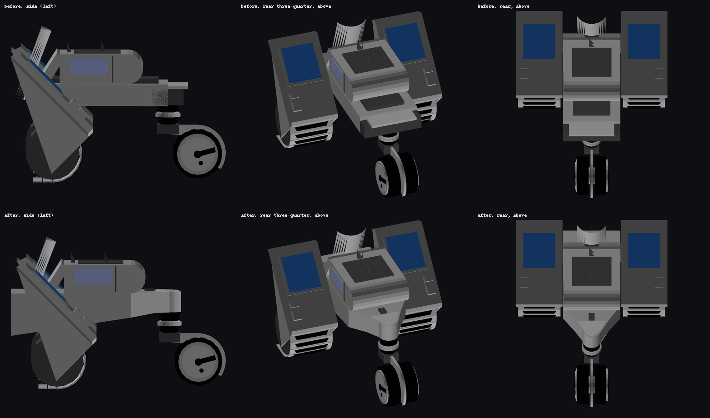

## What changed in v34 — matched curl on the single finger

- **Matched curl.** The single finger's tip now turns toward the paired fingers,
  relative to its own prox, by the same angle the paired fingers' tips turn
  toward it relative to the palm: 21.31 deg each (it was 3.2 deg). The angle is
  derived from the paired fingers' geometry (`FINGER_CURL_ANGLE`), so the two
  stay matched if either changes. The tip keeps its full 47 mm length.
- **Opened to clear finger 0.** The single finger is in line with finger 0, so
  with both tips curled inward they would overlap by about 3 mm. The whole
  single finger is rotated away from finger 0 about its base pivot by just
  enough to leave a 1 mm gap: 2.37 deg (`THUMB_OPEN_ANGLE`). The generator
  finds this angle itself, treating each finger section as a capsule (a slab
  with rounded ends), so it re-opens by exactly what's needed if any finger
  dimension changes (`TIP_CLEARANCE` sets the gap).
- The single finger's grip ridges now follow its prox's actual line and angle.
- Checked on both hands: no single-finger part overlaps any paired-finger part;
  all 31 joints unchanged, and the default pose exact. The ThumbCurl pivot and
  its palm bar did not move.

## What changed in v33 — yoke hood and finger base pins

- **Yoke hood** (from the photograph): a sloped piece covering the centre of the
  yoke's front, between the neck rod housing and the chest. Its flat top shelf
  sits 2 mm under the housing's lower front edge, so the housing rests on it;
  its front slopes down to the chest top, flush with the chest's front face; it
  widens from 112 mm at the top to 156 mm at the bottom and covers the inner
  ends of the yoke windows, as in the photo. It rides with the chest. Checked:
  the front neck rod is clear of it, and nothing else reaches into it apart from
  the yoke and the window ends it covers.
- **Finger base pins**: the single rod across both paired fingers is now two
  pins, each exactly the prox segment's width (19 mm) and centred in its
  finger. Each rides with its own finger's spread joint (FingerSpreadUpper or
  FingerSpreadLower), so when a finger spreads its pivot goes with it and the
  other finger's pin stays put (checked on both hands).
- Joints re-verified: all 31 unchanged; the default pose is exact.
- `johnny5_head.with-backdrop.urdf` was regenerated to carry this robot.

## What changed in v32 — body joints

The body is now a kinematic tree with **31 revolute joints**, in the same
form as the head's (name, axis, limits, effort, velocity). **Every joint's
default, 0, is the pose as built**, so nothing moves until a joint is set.

- **Rooted at the ground.** The lower body (tracks, shrouds, pelvis, caster)
  is the URDF root, `body_root_link`, so it stays on the floor. The chain runs
  WaistLean, ChestTilt, NeckLift, then the head's `base_link`, so bending the
  body moves the head, as on the real robot. At the default pose every frame
  lines up with the world, and the head sits exactly where it did (checked: the
  head's own URDF text is byte-identical, `base_link` is at the origin, and
  every body part is within 1.5 micrometres of its old place, which is decimal
  rounding).
- **Joints sit at the physical pivots**, taken from the parts themselves:
  the shoulder hub seam, the pivot pin's direction, the swivel's axis, the
  elbow hub, the wrist disk, the palm axles and each finger's hinges.
- **Neck linkage.** A URDF cannot close a loop, so the parallelogram uses two
  `mimic` followers: `NeckLiftLevel` (x -1) keeps the neck box, and so the
  head, exactly level, and `NeckLiftFrontRod` (x 0.6164) keeps the front rod
  aimed through its housing (within 3.5 mm over +/-0.3 rad). Viewers that
  support `mimic` move these by themselves; others show them as extra sliders.
- **Paired fingers** sit on separate spread axles, so each has its own curl
  joints, named Upper and Lower to match the spread axles.
- **Not jointed**: the tracks (to be animated separately with the tread frames)
  and the caster (passive).
- Positive directions are mirrored between the arms, and were checked on
  both sides by forward kinematics on the written file (`verify_joints.py`).
- **The J5 Animation Editor** reads these joints and draws them at their default;
  its controls are a fixed list of head joints in its code, so it will not
  drive the body joints until it is given controls for them.

| Joint | Moves | Range (rad) | Effort / velocity |
| --- | --- | --- | --- |
| `WaistLean` | Waist column on the pelvis drum; + leans forward | -0.35 to +0.35 | 60 / 1 |
| `ChestTilt` | Chest on the bellows hinge; + leans forward | -0.35 to +0.35 | 60 / 1 |
| `NeckLift` | Neck linkage rear rods; + raises the head (kept level) | -0.35 to +0.35 | 40 / 1.5 |
| `NeckLiftLevel` | Follows NeckLift x -1: keeps the neck box level | -0.35 to +0.35 | 40 / 1.5 |
| `NeckLiftFrontRod` | Follows NeckLift: keeps the front rod aimed at its housing | -0.23 to +0.23 | 10 / 1.5 |
| `ShoulderRotateLeft / ShoulderRotateRight` | Shoulder hub around the lateral axis; + swings the arm forward | -1.00 to +3.58 | 30 / 2 |
| `ShoulderHugLeft / ShoulderHugRight` | Upright hinge between the yoke indentations | -0.50 to +0.50 | 30 / 2 |
| `ArmTwistLeft / ArmTwistRight` | Shoulder swivel; + turns the forearm outward | -1.57 to +1.57 | 20 / 2 |
| `ElbowLeft / ElbowRight` | Elbow hub; + bends the forearm up | -1.00 to +1.20 | 20 / 2 |
| `WristPitchLeft / WristPitchRight` | Wrist hinge disk; + tips the hand up | -1.00 to +1.00 | 10 / 2 |
| `WristRollLeft / WristRollRight` | Wrist hub; + rolls the top of the hand inward | -3.14 to +3.14 | 10 / 3 |
| `FingerSpreadUpperLeft / FingerSpreadUpperRight` | Upper palm axle (finger 0 and the single finger); + spreads away from finger 1 | -0.20 to +0.60 | 5 / 2 |
| `FingerSpreadLowerLeft / FingerSpreadLowerRight` | Lower palm axle (finger 1); + spreads away from finger 0 | -0.20 to +0.60 | 5 / 2 |
| `FingerCurlUpperLeft / FingerCurlUpperRight` | Finger 0 base hinge; + closes toward the single finger | -0.30 to +0.80 | 5 / 2 |
| `FingerTipCurlUpperLeft / FingerTipCurlUpperRight` | Finger 0 mid knuckle; + curls in | -0.30 to +1.00 | 5 / 2 |
| `FingerCurlLowerLeft / FingerCurlLowerRight` | Finger 1 base hinge; + closes | -0.30 to +0.80 | 5 / 2 |
| `FingerTipCurlLowerLeft / FingerTipCurlLowerRight` | Finger 1 mid knuckle; + curls in | -0.30 to +1.00 | 5 / 2 |
| `ThumbCurlLeft / ThumbCurlRight` | Single finger base hinge; + closes toward finger 0 | -0.30 to +0.80 | 5 / 2 |

## What changed in v31 — finger bends and rounded tips

The fingers hinge only at their pads' pivots: the paired fingers at the base
and mid pads, the single finger at its base pad. The "bend" pads mark a
formed bend in the metal, not a hinge.

- **Bends moved back** to the arrow tips in the annotated screenshot
  (measured along each finger against its pad spacing): the paired fingers'
  bend from 140 to 122 mm along the hand (18 mm back), the single finger's
  from 134 to 113 mm (21 mm back). The bend pads moved with them. The tips
  stay where they were, so the bent tip sections are longer.
- **Rounded inner tips**: every tip section now ends in a full half-round
  (10 mm radius) that reaches exactly the old tip point.
- **Detail from the photograph**: the single finger's rounded tip carries
  five dark grooves across it, as on the real gripper; each paired finger's
  tip has one dark line across its end.
- Grip ridges now sit on the straight section before each bend (three per
  finger).
- Checked: the single finger touches neither paired finger on either hand.

## What changed in v30 — narrow palm, heavier bars

- **Palm bars doubled**: 16 mm wide and 8 mm thick (were 8 x 4 mm); their
  axle eyes doubled to match.
- **Palm narrowed** from 68 mm to 48 mm: just 2 mm wider than the span of the
  three bars across the hand (46 mm), 1 mm each side. The paired fingers'
  bars sit on one side of the hand's centre and the single finger's bar on
  the other, so the palm now sits slightly off-centre, fitted to the bars.
- **Axles narrowed** to the same width, standing 1 mm proud of each palm face
  so their ends stay visible; the middle bolt's heads moved to the new faces.
- Checked: every bar sits inside the palm's height (13-29 mm off centre vs
  the palm's 34); the only contacts with finger parts are within 12 mm of each
  bar's front end, where it attaches to its finger's pivot.

## What changed in v29 — bars centred on the fingers, single finger raised

- **Bars centred on the fingers.** Each palm bar now runs straight back from
  its finger's base pivot, at the finger's mid-height, instead of from the pad
  on the finger's outer face. The palm axles moved to the fingers' heights
  (21 mm above and below centre) so every bar is exactly parallel to the
  hand's axis (checked: 0.00 deg, level with its finger, starting on its axle).
- **Single finger raised to finger 0.** The whole single finger (prox, tip,
  pivot, pads and ridges) moved up to finger 0's height, so its bar also runs
  straight back, onto the same axle as finger 0's bar.
- **Finger 0 is the top finger on both hands.** Because the hands roll in
  opposite directions, finger 0 used to be on top on the right hand but at
  the bottom on the left. The left hand's paired fingers were renumbered
  (geometry unchanged) so the two hands mirror each other and the single
  finger sits up top on both.
- **Single finger's tip opened** (tip at 24 mm below the hand axis instead of
  12) so it clears finger 0 now that they are in line; no overlap remains
  (checked).
- The palm is shorter again vertically (the axles no longer sit out at the
  pads), with the middle hole still a bolt.

## What changed in v28 — finger-spread linkage

- **Two axles and a bolt.** The top and bottom palm holes are the axles that
  let fingers 0 and 1 spread apart; the middle hole is now a bolt, with a
  head on each face.
- **Bars to the base pads.** Each paired finger's bar runs straight back
  from the centre of its base pad (the pad on the end of its base pivot), at
  that finger's centre, to its axle: the axles sit exactly level with the
  pads, so these bars are parallel to the hand's axis (checked: 0.00 deg, and
  each ends exactly on its pad centre and starts exactly on its axle).
- **The single finger shares finger 0's axle.** Its bar runs from that axle
  to its own base pad on finger 0's side; the single finger sits at a
  different height, so this bar climbs at 34 deg.
- **Palm resized to suit.** It is taller (about 78 mm) so both axles fit, and
  shorter (front face at 43 mm instead of 58) so the base pads stand 1.5 mm
  clear in front of it. The fingers did not move (110 parts checked).

## What changed in v27 — palm turned back, with a bar linkage to the fingers

- **Palm rotated 90 deg** about the wrist hub's axis, pivoting on the hub
  centre, relative to the fingers, which did not move (all 110 finger and
  thumb parts checked). This cancels the hand roll for the palm alone, so its
  chamfered profile now faces sideways with its sloping top up, as in the
  photo, and its holes run left to right.
- **The palm holes are axles**: a pin through each, standing 11 mm clear of
  both faces.
- **A bar from each axle to a finger's prox hinge**: to the knuckle at the end
  of each paired finger's prox, and to the bend at the end of the single
  finger's prox (the base pivots sit inside the palm). The top hole drives
  the upper finger, the middle hole the single finger, the bottom hole the
  lower finger. Bars run just outside the palm faces, beside the paired
  fingers on the outside and the single finger on the inside, so none passes
  through a finger (checked); each has an eye on its axle and an end boss at
  its hinge.
- Because the fingers keep their 90 deg roll and the palm does not, the palm
  axles run left to right while the finger hinges run up and down; the bars
  connect the two sets of points.

## What changed in v26 — wrist hinge and palm from the photograph

- **Palm**: now the photo's chamfered block instead of a box: a slanted front
  top, a sloping rear top and cut bottom corners, 50 mm long and 64 mm tall,
  with three holes through its sides. The fingers still pivot inside its
  front. It is a generated mesh (`palm_*.stl`) and follows the hand's 90 deg
  roll, so its profile faces up. Its colour changed from dark to the grey of
  the photo's palm.
- **Wrist hinge**: a thin disk (52 mm across, 14 mm thick) centred on the arm
  instead of the wide 78 mm cylinder. The wrist rod now stops short of it so
  the disk stands clear.
- **Wrist link**: two flat plates, one pressed against each face of the disk,
  with rounded ends around the hinge; the disk's rim shows 8 mm beyond them.
- **Hinge cap**: a small bolt head (11 mm across) on each plate, replacing the
  28 mm caps.
- The hinge centre did not move: elbow to hinge is still 178 mm and the hand
  is exactly where it was.

## What changed in v25 — arm proportions from the photograph

Measured from the arm photograph, using the model's shoulder housing (155 mm
tall, about 205 px in the photo) as the scale:

| Span | Photo | v24 | v25 |
| --- | --- | --- | --- |
| Upper-arm hub to elbow hub | ~260 px | ~105 mm | **200 mm** (`UPPER_ARM_LEN`) |
| Elbow hub to wrist hinge | ~231 px | ~216 mm | **178 mm** (`ELBOW_TO_WRIST`) |

- The upper arm extends along the swivel axis, so the shoulder and swivel are
  unchanged; the forearm keeps its direction and shortens to 150 mm.
- **Upper-arm holes**: the four holes are spaced evenly between the two hubs
  (33 mm pitch, equal gaps to each hub's edge) and grew from 17 to 27 mm
  across, as large as the spacing and link width allow.
- **Forearm**: 20 % narrower left to right (42 to 33.6 mm), with **three holes
  through it** from left to right, 28 mm across, spaced evenly between the
  elbow hub and the wrist.
- The wrist, hand and grippers move with the new wrist position, unchanged.
- Checked: both lengths exact on both arms; no arm part inside any other body
  part, the track shrouds or the housing; the lowest arm point is 75 mm above
  the shroud housing.
- The arm keeps its earlier angles. In the photo the upper arm leans forward
  and the forearm is nearly horizontal; with the chest's 25 deg forward lean,
  the model's forearm hangs steeper than that.

## What changed in v24 — boxed shroud housing, correct mesh lighting

- **Mesh orientation fixed.** The editor lights each triangle by the facet
  normal stored in its STL. 31 of the generated meshes, including the shroud
  plates, housing, strips and treads, were wound inward, so their outer faces
  were lit as if from inside and walls read as flat dark areas. The STL
  writer now orients every closed solid outward by its signed volume; all 96
  body meshes (including every tread animation frame) were checked.
- **Side plates reach just past the tread.** Their upper-rear edge moved out
  to 54.6 mm from the housing line, 3 mm beyond the outermost tread (51.6 mm).
  Corner angles are unchanged (A and C 90 deg, D 135 deg, E 118.8, B 106.2).
- **Tier boxed in.** The housing tier is now a full-width box, 30 mm tall,
  sitting on the plates with its side walls flush with the plates' outer
  faces, so plate and tier form one continuous wall and the treads are
  enclosed. The old inner base block is gone. A raised cap on top carries the
  blue panel, and the notched pad sits on top near the outer side.
- **Housing blue** is now `iris_blue`, the same as the shroud strips.
- Treads: every tread point treated as hidden lies inside the plates; the
  animation frames were regenerated.

## What changed in v23 — refined track shrouds and front hubs

- **Top edge along the tread plates.** The shroud's top edge now runs exactly
  parallel to the front tread run (28.8 deg), at the level of the tread
  plates' outer faces, so the plates are covered from the side and the pads
  stand 3.8 mm above the edge. Verified at points along the run: 0.00 mm
  offset, 0.000 deg off parallel.
- **Corner angles.** The front run rises at 28.8 deg rather than the real
  robot's 45, so not every corner can keep its earlier angle. Kept exactly:
  front A 90 deg, rear C 90 deg, rear-bottom D 135 deg. Changed: front-bottom
  E is now 118.8 deg (the front edge stays perpendicular to the top edge) and
  the top corner B, mostly under the housing, is 106.2 deg.
- **Double-thickness plates** (8 mm). The inner plate moved out to hug the
  belt edge (0.5 mm clear) so it still clears the drum (0.5 mm) and caster
  arm (1.5 mm); the drum was trimmed 2 mm to suit.
- **Sprocket covers removed**, so the shroud is the outermost surface over
  the sprocket. The rear-roller covers remain.
- **Front hubs nearly flush**: the hub stands 2.5 mm proud of the belt edge,
  with its cap and five bolts on that face; still listed as the rotators in
  the tread animation manifest.
- **Strips** along the bottom edge are now `iris_blue`, the same blue as the
  waist panels, and their ends follow the actual front and rear edges.

## What changed in v22 — shoulder housings

From the shoulder photograph:

- The **shoulder housing** now rises from the swivel as a cylinder: round
  front and back (55 mm radius), flat inner and outer sides 54 mm apart. The
  inner side sits flush against the hub's outer end.
- Its **top follows the shoulder hub's circle** about the hub axis, so seen
  from the side the housing and hub read as one rounded shape. Verified:
  every top vertex is exactly 60.000 mm (the hub radius) from the hub axis.
- An **inset plate** on the flat outer side (red arrow): a pale,
  tombstone-shaped plate 6 mm in from the edges, set into a dark border, its
  rounded top concentric with the hub.
- The **swivel collar** grew from 41 to 50 mm radius so the housing visibly
  continues up from it.
- The old box bracket, its rounded top and the outer-face window were removed.
  Both housing and plate are generated meshes (`shoulder_housing_*.stl`,
  `shoulder_plate_*.stl`).

## What changed in v21 — angular track shrouds with a back housing

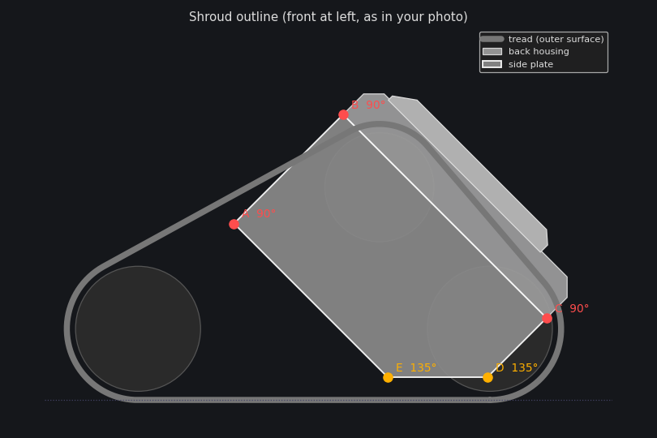

From the side photograph of the track:

- **Side plates**: 90 deg corners at the front (A), top (B) and rear (C), and
  135 deg corners (D, E) where a flat bottom edge runs just above the bottom
  tread. A 135 deg corner against a horizontal edge forces the other edge to
  45 deg, and the 90 deg corners then force every edge to 45 deg, so the
  outline is a rectangle rotated 45 deg with its bottom corner cut off.
  Verified: 90.00 deg at A, B and C; 135.00 deg at D and E.
- **Placement**: B just above the sprocket; A just under the front tread run;
  C on the rear roller's upper rear; the bottom edge (137 mm) at the old
  bottom height. The front roller and the back of the rear roller are left
  exposed, as in the photo. `SH_B`, `SH_KA` and `SH_KC` in `build_robot.py`
  set the corners.
- **Back housing** (green arrow): a thick sculpted block along the B-C edge,
  the full shroud width, replacing the old curved wrap. A 60 mm base with
  chamfered ends, an 86 mm upper tier inset 18 mm each side, a blue panel on
  the tier and a notched pad on the outer side. It covers the sprocket top
  and the whole rear-upper tread run with at least 8.4 mm to spare; every
  belt point treated as hidden was checked to lie inside it.
- **Blue strip** along the bottom edge now follows the 45 deg ends, with two
  diagonal panel lines, as in the photo.
- **Treads**: links are hidden only while fully under the housing, so the
  animation frames were regenerated; 42 links show per side in every frame.

## What changed in v20 — tread animation frames

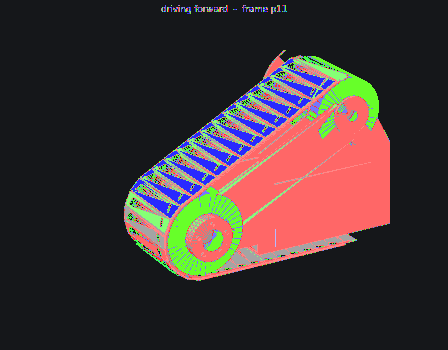

The treads can now be animated by the editor. The generator writes
**12 frames per side** into `Meshes/Body/Treads/`: the tread plates and the
pads, each frame with every link shifted 2.61 mm (a twelfth of a link) along
the true belt path. Twelve steps make exactly one link, so the frames loop
seamlessly.

- `tread_animation.json` describes the frames for the editor: which URDF
  visuals to swap, the step size, which way is forward, and the front hubs
  to spin with the belt.
- Frame 0 is identical to the static mesh, so the model looks the same
  when the feature is off. The grey band is uniform and has no frames.
- Links appear and vanish only under the shroud's wrap, where they cannot be
  seen (41 or 42 visible per side, depending on the frame).
- **Hub bolts**: five bolts on each front roller hub, so the hub's rotation
  shows. The manifest's rotation rate keeps hub and belt locked: one hub turn
  per 540.4 mm of belt, the roller's circumference.
- Verified: frame 0 equals the static mesh; one full link of shift reproduces
  frame 0 exactly; each frame moves the bottom run 2.61 mm; every manifest
  name and path resolves against the written URDF.

**The editor needs code to play the frames.** It does not animate them yet.
`REQ-tread-animation.md` in this folder specifies that work for the editor:
loading the manifest, swapping geometry each frame from an accumulated belt
distance, spinning the hubs, left and right speed controls, and acceptance
tests that run without the WPF view.

## What changed in v19 — cleaner tread pads

- **Rivets removed.** The plate mesh drops from about 11,000 to 504
  triangles per side.
- **Pads flipped.** Seen from the front on the front run, each pad is now
  narrower at the top (the edge toward the sprocket, 119.5 mm) and wider at
  the bottom (133.5 mm). All links flip together, as identical links on a
  real belt would.
- **Pads thickened from 3.5 to 3.8 mm** to take the rivets' place as the
  belt's outermost surface, so the tread still rests on the floor (lowest
  point 0.1 mm clear) and the rollers still clear the ground by exactly the
  12 mm belt thickness.

## What changed in v18 — patterned treads

From the tread photograph, with every size a ratio of the belt width:

| Feature | Photo ratio | Model (170 mm belt) |
| --- | --- | --- |
| Link pitch | 0.18 | 31.3 mm (54 links; the pitch divides the loop exactly, so the pattern closes seamlessly) |
| Pad across the belt | 0.79 | 133.5 mm long edge, 119.5 mm short edge (trapezoid: ends cut back 7 mm) |
| Pad along the belt | 0.09 | 15 mm |

- **Solid grey band** (red arrow) under the whole belt, 4 mm thick, swept
  round the full closed loop.
- **Grey link plates** the full belt width, 4 mm thick, with a 2.2 mm gap so
  the band shows between them.
- **Black trapezoidal pads** (green arrow), 3.5 mm thick, each with eight
  rivets, four along each long edge.
- The pattern runs **from the floor, round the front roller wrap, up the
  front run and over the sprocket to the shroud**: 42 links per side are
  built; the 12 under the shroud's wrap are left out.
- Built along the true belt path (three tangent runs joined by arcs round the
  front roller, sprocket and rear roller). Each side is three meshes: band
  (`gray`), plates with rivets (`light`), pads (`black`) — about 14,600
  triangles per side instead of ~800 extra primitive parts.
- **Belt thickness is still 12 mm** (band 4 + plate 4 + pad 3.5 + rivet
  heads). The rollers still clear the ground by exactly the belt thickness,
  and the tread rests on the floor: flat links bridge the roller curves, so
  the rivet heads stop 0.2 mm short to keep every point on or above the ground
  (lowest point 0.1 mm clear).
- The old black belt runs, black roller wraps and separate tread cleats were
  removed; the rollers themselves now show inside the band.

## What changed in v17 — notched waist with the black disk

From the close-up of the lower waist:

- The 150 mm electronics block, which was wider than the 142 mm waist band,
  is gone. **Nothing below the band is wider than it now** (widest part 128 mm).
- **Notch**: from just under the lower band down to the pelvis front housing,
  the front half of the column is open; a solid rear half-column (a mesh,
  `waist_column_rear.stl`) stays behind it.
- **Black disk** (red arrow): 128 mm across, facing forward, set into the
  notch with a dark rim, and an arc of eleven copper studs round its rim on
  the robot's left.
- **Rectangular panel**: 95 mm wide, in front of the disk, so the disk's
  left and right edges show 16.5 mm either side. It runs from the top of the
  notch to the top of the pelvis front housing (its front edge meets the
  housing top to within 0.1 mm; the back of its tilted base sits just inside
  the housing, hidden).
- **Panel detail**, laid out in the close-up's pixel positions: U bracket and
  an eleven-bar copper contact strip on the left; two dark squares, a tan
  connector block with dots and copper pads, a module with a pale plug and an
  arched module with a tan plug in the middle-left; a pale tall block, a copper
  block and an orange-and-black striped part in the middle; a dark top, a
  gold star module with a button, a module with copper and gold pads, a tan
  bar and a large module with three copper studs on the right.
- The pelvis hinge cheeks were shortened so they stay behind the disk.

## What changed in v16 — curved pelvis front with lower blue panels

From the close-up of the pelvis front:

- The tapered upper housing now stops at a **band of panel plates** (three
  plates with dark seams and two small tabs), 30 mm below the drum axis.
- Below the band the housing becomes a **curved shell, concentric with the
  drum**, wrapping round its front from 13.5 deg below horizontal down to the
  drum's bottom. Its outer radius (128 mm) meets the taper's front edge
  exactly, so the transition is seamless; it is the full width between the
  shroud plates (220 mm).
- **Two blue panels** (`iris_blue`) sit side by side on the curved shell just
  below the band, split by a centre seam that runs on down to the bottom,
  with a screw near the bottom as in the photo.
- The upper blue panel now runs almost the full height of the taper on its
  right half, as in the photo; the old centre seam and horizontal line on the
  taper were removed (the band replaces them).
- `pelvis_front_seam.stl` and `pelvis_front_line.stl` in `Meshes/Body` are no
  longer used by v16; they are kept only so `johnny5_head.body-v15.urdf` still loads.

## What changed in v15 — waist detail from the photograph below the chest

The photo was mapped onto the column: vertically from the top of the column to
the top of the pelvis drum, horizontally by the column's 136 mm diameter.

| Area (arrow) | Now |
| --- | --- |
| Waist bellows (green) | 100 mm long (was 72) with 26 fine convolutions (was 14), tapering from 190 mm at the chest. The lower half runs 64 mm down the column; the column's plain top was shortened to match, so the hinge and the pose are unchanged. |
| Column | Now grey, as in the photo, with an upper band carrying side modules: three round buttons on the robot's right, a block of tan, copper, red and gold chips on its left. |
| Blue panels (upper yellow arrows) | Two curved panels wrapping the column front with a seam down the middle, in `iris_blue` — the same blue as the fingertip pads. A black strip runs down the robot's right edge. |
| Side electronics (red, right) | A dark module on the robot's left side of the column, with a vertical stack of copper, tan, gold and black parts and a knob. |
| Lower electronics (red, left) | A wider grey block around the lower column: a recessed front panel with a nine-contact copper strip, a 4 x 4 grid of components, and a copper-toothed disc with a hub. |
| Pelvis front (lower yellow arrow) | A tapered housing on the front of the drum, narrow at the top and wide at the bottom, with an `iris_blue` panel on its upper right, a small grey tab, a centre seam and a panel line. |

Clearances checked: no new module overlaps existing structure; the pelvis
housing stays inside the shroud plates (half-width 110 mm vs 117.5 mm) and
26 mm clear of the lower electronics block.

## What changed in v14 — shoulder hub moved in, second shoulder pivot

From the shoulder photograph:

| Feature | Detail |
| --- | --- |
| Shoulder hub (red arrow) | Moved inward so its seam is at the window's outer end: seam at \|y\| = 0.166 (was 0.203), hub 0.169 to 0.244, same 75 mm length. The yoke now ends at the seam (326 mm long). |
| Second pivot (green arrow) | A pin running front to back, 18 mm in from the hub's outer end and 40 mm above its axis, with a head showing on the front and back faces. The bracket swings the arm outward about it. |
| Indentation (yellow arrow) | A smooth scoop cut into the bottom of the hub's outer end, 32 mm deep at the bottom and fading to nothing at the sides, so the bracket can swing into it. The hub is now a generated mesh (`shoulder_hub_left.stl`, `_right.stl`) because primitives cannot make the scoop. |
| Bracket | Now outboard of the hub end (centre \|y\| = 0.271, was 0.255), rising to the pivot height with a rounded top. The old blue end cap and boss were removed; the hub's outer end now carries the bracket. |

The elbow, forearm and hands are unchanged; the upper arm now leans inward
3.6 deg from the swivel to the elbow. Pivot position and scoop depth are
`PIVOT_IN`, `PIVOT_UP` and `SCOOP_D` in `build_robot.py`.

## What changed in v13 — pelvis drum and tread widths from the photograph

Measured from the front photograph of the tracks, at matching depth, using the
full belt (tread plates plus black edges) as the reference:

| Feature | Photo, x belt width | Model v12 | Model v13 |
| --- | --- | --- | --- |
| Gap between belts | ~1.43 | 0.95 | **1.47** |
| Drum diameter | ~1.24 | 0.85 | **1.24** |

Holding the tracks' outer span fixed at 590 mm (`TRACK_OUTER_SPAN`):

- **Belts** narrowed from 200 to 170 mm (`BELT_W`); rollers, wraps, treads, frames
  and shroud plates all follow.
- **Drum** grew from 170 to 210 mm diameter (`DRUM_R` 0.105) and from 172 to
  232 mm long, filling the gap between the shroud plates (1.5 mm clear each side).
- **Drum top kept just below the treads**: 2 mm under the tread top over the
  sprockets. The bigger radius therefore puts the drum axis 20 mm below the
  sprocket axis; the hip axles still enter the drum at the sprockets.
- **Waist hinge moves with the drum**: the column keeps its 0.578 m length and
  21 deg tilt, so the pose solver lifted the tracks 20 mm relative to the head.
  Ground is now z = -1.0774.
- **Caster arm and rear housing** widened with the gap (arm 232 mm), still the
  full width between the tracks; the arm attaches centred on the back of the
  larger drum.

Measurement precision is roughly +/-10 %: the photo is a perspective
three-quarter view, and edges were read against a pixel grid.

## What changed in v12 — chest from the front photograph

| Area | Now |
| --- | --- |
| Shell | Squarish, with chamfered upper corners (a generated mesh, `chest_shell.stl`) |
| Collar | Tapered block rising from the chest top up into the yoke, sloping back (`chest_collar.stl`) |
| Front face | Two recessed circuit-board panels (the right one stepped) over a wide lower panel with eight connector pins; each panel has a thin border |
| Components | Placed from the photo: resistors (pale tan), copper pads, small red parts, gold stars, a raised module, blue-grey chips, dark pads and bars |
| Flange | Black flange under the shell with four screws along its front |
| Waist bellows | Tapered: 188 mm across at the flange, narrowing to 147 mm at the hinge and on down to the waist |

- Front-face parts were laid out in the photograph's pixel coordinates and
  mapped onto the chest face, so their arrangement matches the photo; the
  chest is squatter than the photo's, so the layout is compressed vertically.
- Three more head-palette colours are used, all static (the editor never
  drives them): `step_gold_polished` for resistors and pins, `cad_d89d8b`
  for copper, and `mouth_red` for the red parts. The mouth LEDs use separate
  `*_dynamic` materials, so they are unaffected.
- The bellows bends 46 deg between the forward-leaning chest and the
  backward-leaning column, so it closes up at the front and opens at the
  back; less of it shows from the front than in the upright photo.
- The old tapered lower corners, sloped top, dark top block and single-board
  front were removed. The side unit, hose and arms are unchanged.

## What changed in v11 — cylindrical yoke

- The body yoke is now a **cylinder running left to right** (radius 55 mm, just
  inside the 60 mm shoulder hubs), between the two shoulder rotation seams. The
  box, top rail and separate rear tube are gone.
- The two windows are **stadium-shaped**: a straight top and bottom with round
  ends, sitting on the curved front, with the inner tube lying in each.
- Because the chest leans forward 25 deg, the windows face slightly downward
  along with the rest of the chest.
- The neck linkage re-seats on the curved surface: the rear-axle brackets and
  gearbox reach down into the curve, and the front rod's slot housing sits
  square to the surface where the rod meets it. The cylinder's top is higher
  than the old box's, so the pose solver moved the body 13 mm down and 6 mm
  back to keep the neck box exactly under the head. The front rod lengthened
  from 113 to 148 mm because it now meets the cylinder's curved front.
- Rechecked: all angles exact; box under the neck; rollers level with 12 mm
  belt clearance; belts and casters on the ground (now z = -1.0974); no head
  geometry inside any body part except the neck base in the box.

## What changed in v10 — track shrouds and caster arm detail

### Track shrouds

Each track now has a shroud, following the edge points marked on the v9 render
and the side photograph:

| Edge | Where it runs |
| --- | --- |
| Front edge | 10 mm inside the front-upper tread run, so those treads stay visible |
| Top | Steps out at the sprocket's top-rear (115 deg) and wraps **over** the tread |
| Rear | The wrap covers the whole rear-upper run and the back of the rear roller |
| Bottom | Just above the bottom tread, so the belt shows beneath (31 mm above ground) |
| Front roller | Left exposed with its hub, as in the photo |

- Side plates on **both** faces of each track, 4 mm thick; the wrap sits 12 mm
  above the belt so it clears the tread plates.
- The outline follows the belt curves, so the shroud is a generated **binary STL**,
  `Meshes/Body/track_shroud_left.stl` and `_right.stl` (480 triangles each),
  referenced from the URDF like the head's meshes. `build_robot.py` rewrites
  them every run (into `../Meshes/Body`, or `$J5_MESH_DIR` if set).
- Bolted covers on the shroud over the hidden sprocket and rear-roller axles,
  and a blue strip with a panel line along the lower edge. The outboard hubs of
  those two rollers were removed, since they sat under the shroud.
- The pelvis drum and caster arm narrowed from 186 to 172 mm so they fit
  between the shroud inner plates (1.5 mm clear each side) — the arm is still
  the full width between the tracks.

### Caster arm

From the side photograph:
- **Rear housing** over the arm: flat top with a recessed dark panel, sloped
  front (it stays 40-67 mm behind the tilted waist column), rounded tail,
  blue-grey side panels with a panel line.
- **Grab handle** on top, on two posts.
- **Plate** over the caster spring.
- **Large domed hub caps** on each twin wheel's outer face, with a rim and
  centre bolt; the fork plates moved out to clear them.

## What changed in v9 — shoulder rotation and arm swivels

Each arm now runs: shoulder bar end -> **rotation seam** -> shoulder hub ->
housing -> **swivel** -> upper arm -> elbow.

| Part | Detail |
| --- | --- |
| Shoulder rotation | A dark seam ring on the shoulder bar's lateral axis at \|y\| = 0.203 (`SHOULDER_SEAM_Y`); the hub turns on the bar end here. The yoke now ends just inboard of it (0.400 m wide, was 0.440). |
| Shoulder housing | Hangs below the hub, 74 x 54 mm, with a window and divider in its outer face. |
| Swivel | Ringed collar with two grooves and a lip, its axis exactly along the upper arm, so the arm twists about its own length. |
| Upper arm | Now starts below the swivel, with a dark hub at its top and four round holes down its outer face (replacing the slot). |

The swivel is 44 % of the way from the shoulder centre to the elbow, lower than
the ~28 % in the arm photo. The model's shoulder hub is about twice the size of
the photo's relative to the arm, so at 28 % the housing would be hidden inside
the hub. `HOUSING_SHOW` sets how much housing shows below the hub (35 mm);
reducing it moves the swivel up and lengthens the upper arm. The elbow,
forearm, wrists and hands are unchanged.

## What changed in v8 — two-axis wrists

Each wrist now has two swivels in series:

forearm -> wrist rod -> **hinge swivel** (up/down) -> short connecting body ->
**roll swivel** disk (about the hand's pointing axis) -> hand

| Part | Detail |
| --- | --- |
| Hinge swivel | On the wrist rod's axis, 12 mm back from its end (`WRIST_HINGE_BACK`). Axis runs side to side so the hand hinges up and down. Dark, 40 mm diameter, 78 mm long so it shows on both sides of the rod, with grey end caps. |
| Connecting body | 30 mm (`WRIST_LINK_LEN`), 36 x 40 mm section, from the hinge centre forward along the hand's pointing axis to the back face of the roll disk. |
| Roll swivel | The existing 12 mm wrist disk, now 36 mm from the hinge centre instead of overlapping the rod end. |

The hand moved forward with its disk; its geometry and 90 deg roll are unchanged.

## What changed in v7 — grippers

Each hand is rebuilt from the gripper close-up as a rigid assembly around a
**wrist rotation disk** at the back of the palm, then rolled 90 deg about its
pointing axis so the **single finger faces inward** toward the body centreline
(-90 deg on the left hand, +90 deg on the right). The paired fingers now stack
vertically, 42 mm apart.

| Joint | Blue domed pads |
| --- | --- |
| Paired fingers' shared base axis | 2 — one on each outside of the pair |
| Each paired finger's second axis | 2 per finger, both sides (4) |
| Each paired finger's inward bend | 2 per finger, both sides (4) |
| Single finger's axis | 2, both sides |
| Single finger's inward bend | 2, both sides |

14 pads per hand. Each pad is a short blue base disc with a dome, on the
lateral faces so it lines up with the axis centre. Ridged grip faces on the
paired fingers face the single finger and vice versa, with a small opening
between the tips. Hand geometry is at the top of the `HANDS` section of
`build_robot.py` as `(forward, up)` points in the hand's own frame.

The rest of the body is unchanged from v6.

## What changed in v6 — posed like the side photograph

All angles are absolute, measured off world vertical in the final pose:

| Part | Angle | Hinge |
| --- | --- | --- |
| Waist column | 21.0 deg back | Pelvis drum, coaxial with the track sprockets |
| Chest (with yoke, arms, side unit) | 25.0 deg forward | Waist bellows |
| All three neck rods | 41.5 deg forward | — |
| Neck box | level | carries the head |

- **Waist column** now runs the full distance from the pelvis drum to the
  bellows hinge (0.578 m). The pelvis upper block, bridge and hip ring are gone;
  the column's lower yoke wraps the drum as a hinge collar with cheeks.
- **Bellows hinge**: a pin with blue caps and cheeks at the bellows centre; the
  bellows is split so its lower half follows the column and its upper half
  follows the chest.
- **Neck linkage**: with the chest at 25 deg and the box level, the three rods
  cannot form a parallelogram. The driven rear rods keep their 84 mm length.
  The passive front rod slides in its slot, so its length (0.113 m) follows
  from where its 41.5 deg line meets the yoke, and the slot housing sits at
  that point.
- **Placement**: the chain is built from the tracks up, then the whole body is
  translated so the box lands exactly under the fixed neck base. The ground
  moved with it and is now at z = -1.0845.
- **Twin casters**: moved straight back 0.182 m (the arrow on the v5 render,
  scaled by the caster wheel's own diameter). The 62 mm wheel was made 50 %
  wider (93 mm) and split into two 46.5 mm wheels separated by 25 % of their
  combined width (23.25 mm), on one axle with outer and centre fork plates.
- **Caster arm** attaches low, centred on the back of the pelvis drum, and is
  the full width between the tracks (186 mm of 190 mm, 2 mm clear each side).

Checked after posing: angles exact to 0.01 deg; box centre unchanged under the
neck; rollers level with 12 mm belt clearance; belts and both caster wheels on
the ground and nothing below it; no head geometry inside any body part except
the neck base inside the box, as intended.

## What changed in v5 — three-rod neck linkage

Built from the close-up photo, scaled by the orange Fabco cylinders (0.072 m in
the model, ~157 px in the photo, so ~0.46 mm per pixel).

| Feature | Detail |
| --- | --- |
| **Neck box** | 84 x 84 x 28 mm, centred on the neck axis. Its top (z = 0.1375) sits 3.5 mm above the underside of the neck's wide shallow base cylinder, so the base is just inside. The base turns with `NeckTurn`; its radius (35.8 mm) fits inside the 42 mm half-width at every yaw. It replaces the v4 riser, collar and clevis. |
| **Front rod** | Passive, on the centreline 28 mm ahead of the neck axis. Pivots under the front of the box on a knuckle with grey torsion springs either side, then runs down through a sleeve into a slot in a raised housing on the shoulder yoke. |
| **Rear rods** | Coil-spring covered, 30 mm behind the neck axis. Top pivots on lugs outboard of the box (pin heads visible, as in the photo), at y = ±0.052; bottom pivots at y = ±0.057 on brackets at the back of the yoke. |
| **Shared driven axle** | One axle through both rear rods' bottom eyes, with a drive hub at the centre and a gearbox behind it. |
| **Geometry** | Both rods 84 mm. Pivots form a parallelogram at the neutral pose. |

**The body dropped 90 mm to make room.** In v4 the shoulder yoke sat only 6 mm
below the neck base, and the head cannot move, so every body part moves down by
`BODY_DZ = -0.090`. The ground moved with it (now z = -1.1828), so every earlier
constraint still holds exactly: rollers level with 12 mm belt clearance, belt
underside and caster wheel on the ground, nothing below it. The robot is now
about 1.56 m tall.

The linkage is static at its neutral pose. Making it articulate would mean
giving the rear axle a joint and mapping a control to it in
`servo_joint_map.json`, plus moving the neck with it — which would modify the
head chain, so it has been left out.

## What changed in v4

- **Sprockets moved** to the point marked on the v3 render: centre
  `x = 0.000, z = -0.800` (was `0.153, -0.696`), i.e. 153 mm rearward and
  104 mm lower, centred fore-aft between the rollers. The position was read off
  the screenshot using the roller spacing (0.484 m) and sprocket height as
  scale, so it is accurate to roughly a centimetre; `SPROCKET_X` and
  `SPROCKET_Z` in `build_robot.py` are now plain values for fine-tuning.
- **Tracks follow automatically**: belt runs are re-solved as tangents to the
  new sprocket position, and the tread plates, side-frame struts and hubs are
  all positioned from it. Track top is now z = -0.713.
- **Pelvis re-seated**: the pelvis drum is now coaxial with the sprocket axle,
  so the tracks hang from it, and a tapered bridge with a blue front panel
  carries it up to the waist. The blue panel and chips moved to the front of
  the upper pelvis block.
- **Laser removed**, along with its mount, column, collar, band and window.

## What changed from v2 to v3

| Area | v3 |
| --- | --- |
| **Tracks** | Triangular, as in the side view: front and rear rollers low and level, a drive sprocket high near the hip. The measured track top (z = -0.609) is the sprocket's belt. Tread plates on both upper runs; inboard and outboard side frames; hubs outboard. |
| **Hip** | Rounded pelvis drum between the tracks, carrying them on axle housings at the sprockets. Replaces the splayed legs. |
| **Shoulders** | Flat-fronted yoke with the two oval windows and the tube visible inside each; large rotary shoulder hubs with blue-grey caps. |
| **Arms** | Flat slotted upper-arm links with piston rods, elbow hubs, forearms, wrists, and three-finger grippers — two fingers and a thumb, with the blue domed pads from the close-up. |
| **Chest** | Sloped top, tapered lower corners, recessed front panel with two circuit boards and an eight-pin gold connector row. |
| **Side unit** | Box with a coiled black hose on the robot's right. |
| **Waist** | Corrugated bellows under the chest; blue column with grey bands, front chip panel, and side electronics panels. |
| **Caster** | Still behind the treads on a beefy centreline arm off the back of the pelvis; now with a spring bellows and a fork. |

## Constraints carried over, and checked

| Requirement | Value |
| --- | --- |
| Neck base just inside the box | Box top 3.5 mm above the base cylinder's underside; contains it at any yaw |
| Pose angles (off world vertical) | Waist column 21.0 deg back, chest 25.0 deg forward, all three neck rods 41.5 deg forward; neck box level |
| Front and rear rollers level | Both axles at z = -0.9794 |
| Roller clearance = belt thickness | Exactly 12.0 mm above ground (belt 12 mm) |
| Belt width = roller wrap width | 170 mm |
| Tread on the ground | Ground z = -1.0774; lowest tread point 0.1 mm clear, nothing below |
| Caster behind the treads | Twin wheels at x = -0.450, 272 mm behind the rearmost belt point; both on the ground |
| Palette | Only materials already defined in the head model, including on every mesh; nothing ending in `_dynamic` |
| Behaviour | 648 parts (50 of them meshes) on a jointed tree: 31 revolute body joints (2 of them `mimic` followers), rooted at the lower body; no `<collision>` elements; the J5 Animation Editor holds body joints at their default |

## Scale

The model is proportioned to your head (0.3175 m wide), so the whole robot
stands about 1.46 m from ground to the top of the head — larger than the screen
prop in absolute terms, but proportionally matched to the photographs. For
compositing only the proportions matter.

## Regenerating and previewing

`build_robot.py` defines every part in world coordinates, grouped by area, with
small helpers (`box`, `cyl`, `strut`, `rod`, `bellows`). Track belts are solved
as the outer common tangents of the three rollers, so changing a roller's size
or position keeps the belt wrapped correctly.

`render3d.py` renders any URDF in this folder, head meshes included, by running
forward kinematics over the joint tree:

    python render3d.py ../johnny5_head.urdf out.png

`legacy/` holds the earlier generators (`build_robot_v36.py` back to `_v3`), and the v2
generators that build the torso-only and v2 variants.

## For chromakey

Green screen, not blue: the body's blue-grey panels (`cad_97a3da`) and the
gripper pads (`iris_blue`) would key out against blue.

## Chest yoke hood photo detail

The center hood beneath the cylindrical yoke now has a narrower raised brow,
a two-stage sloping front, widening cheek panels, clipped corners, and small
top/bottom edge bevels based on the physical-robot reference photograph. A
recessed dark gasket separates it from the chest. This is a visual approximation
from one photograph, retaining the existing mounting frame and joint hierarchy.
The shell and gasket use 112 triangles in total. `yoke_hood_detail.py` defines
the geometry and is called by `build_robot.py`; only these hood assets were
regenerated for this revision.

## Hand closing stops (2026-09-29)

The stock pose is already nearly closed. Closing limits now stop the rounded
finger and thumb envelopes at a common plane between them, with 0.02 mm
clearance per side. Finger base maximum is 0.002424 rad, fingertip maximum
0.003995 rad, and thumb maximum 0.002437 rad; opening remains -0.30 rad.
These supersede the older joint table above, on both hands and both fingers.

The `johnny5_hand_closure` version 1 marker enables the editor's additional
combined base/tip constraint. Both requested bends are reduced proportionally
when their combination would cross the plane, including with configuration
overrides and Collision Safeguard off. Spread, wrist and arm articulation remain
independent. This is a hand closing-plane stop, not general robot collision
avoidance. Other URDF viewers only enforce the individual limits.

The generator imports `hand_closing_limits.py` and preserves the marker. This
constraint is specific to the v34 geometry; changes to finger dimensions require
recalculating the plane and envelopes in `HandClosingLimits.cs` as well.
Former stock calibration maxima migrate when loaded; custom calibration values
are preserved but cannot bypass the marked model's closing stop.
Source/model edits only: not compiled or motion-tested yet.

## Shoulder pivot recesses

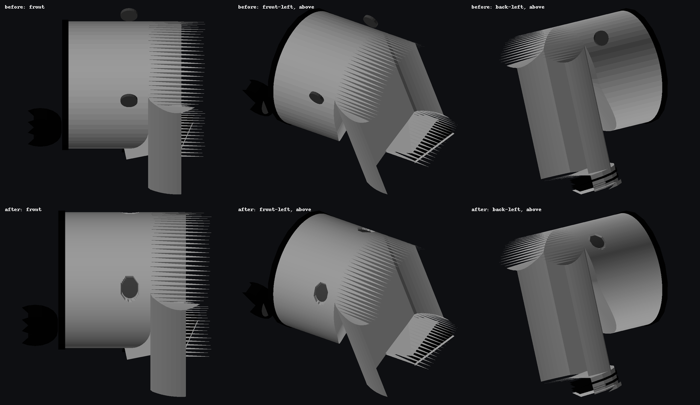

The shoulder pivot-pin rods are omitted from the visible URDF; their construction
references remain in `build_robot.py` to preserve the ShoulderRaise joint pivots.
Where the pin's ends meet each shoulder hub, front and back, the hub now has a
shallow round recess instead of a raised head: 16 mm across and 2 mm deep,
following the hub's curve (`PIVOT_RECESS_R`, `PIVOT_RECESS_D`). The recesses are
cut into the hub mesh itself, whose curved surface is a finer grid in the
columns round them (about 2,800 triangles per hub, was 256). A thin dark lining
(still named `shoulder_pivot_head_*`) covers each recess floor.

## Inboard track details (2026-10-15)

Added mirrored inner front axle covers, raised intermediate bearing covers, and
connecting frame webs with raised lips from the supplied oblique reference photo.
The existing 170 mm belt width is the scale reference. Front covers are 148 mm
in diameter with 32 mm barrel depth; intermediate covers are 118 mm in diameter
with 38 mm barrel depth. Seats and stepped caps add a few millimetres. The
intermediate centres sit 155 mm behind and 85 mm above the front roller centres.
These are visual estimates, particularly depth, rather than measured dimensions.
The covers are fixed frame hardware; tread animation and movement joints are
unchanged. `track_inner_details.py` is shared by the generator and the update.

## Outboard track details (2026-10-15)

Added mirrored rounded outer axle guards, stepped panels, small axle caps,
upper edge lips and lower frame rails from the second reference photograph.
Scale is estimated against the 172 mm roller diameter. Guard nose diameter is
158 mm, base thickness 5 mm, panel steps 1 mm. Rear tabs and trim remain inside
the outer shroud plane; no exposed red-arrow fastener hole is added. Covers
are fixed frame hardware and do not join the rotating tread hub animation.
`track_outer_details.py` supplies the geometry for future regeneration.

The outboard guard assembly was moved 5 mm farther outward on each side to
clear the pre-existing hub faces. Rear cover tabs remain beneath the outer
shroud surface. This includes disks, rims, caps, panels, lips and frame trim.

Outer cover correction: exposed guard faces now stand an additional 12 mm
outboard (17 mm beyond the original placement), tapering back to the prior
depth at the rear shroud tab. The added axle caps are recessed behind the
cover disks rather than protruding through them. Existing movement pivots
and tread animation definitions are unchanged.

## Revised outer track support from clearer reference

Supersedes the broad guards and successive depth offsets described above.
The exposed circular hub now has a stepped rim and ten radial lugs. A narrow
48 mm-wide diagonal support crosses its face, with a flush axle end at the
nose, three raised panels, an angular lower web, upper rib, screw details and
a boxed lower rail. The support projects 23 mm beyond the belt edge at the
front and returns under the existing shroud toward the rear. Both sides match.
The new hub face/rim/lugs participate in tread rotation; the support and axle
end remain fixed. Geometry is photo-proportioned, not measured from the robot.
`update_outer_track_details.py` regenerates only these details and updates the
tread manifest, leaving other model parts unchanged.

## Flat recessed outer track support

The previous rear depth taper has been removed. The support face is now flat,
2 mm inside the belt outer edge; its raised panels clear the shroud inner face
by 1 mm. The hub rim outer face is 15 mm inside the belt edge, with the hub
face and lugs between it and the support. The original front roller barrel
is shortened at its outboard end and the older hub hardware moved inward to
avoid burying the new details. The inboard barrel face, axle X/Z centres,
roller radius, flush axle end and tread path remain unchanged.

### Caster support photo details

Added photo-proportioned detail around the caster arm: a pair of lower braces
attached to the stationary caster collar, a long black hydraulic cylinder with
an exposed shaft, a second shorter black cylinder and saddle, an upper hinge
with separate knuckles and leaves, and deeper side cheeks with inset panels.
Dimensions are visual estimates against the existing caster and arm geometry,
not measurements of the physical assembly.

These are visual details only. The collar braces follow `body_caster_collar_link`;
the cylinders, hinge and cheeks follow the body root. They do not change the
wheel/fork steering joints, control ranges or physical hardware mappings.
`caster_arm_details.py` supplies the shared geometry definition used by
`build_robot.py`. `update_caster_arm_details.py` updates only these additions in
the existing URDF without regenerating unrelated model parts.

Caster brace attachment correction: the arm housing now extends downward at
its rear shoulder to support the brace, matching the clarified blue-arrow
reference. Both braces terminate inside that housing, 70 mm rearward of the
previous endpoints, rather than reaching forward toward the track shroud.
The new lower housing and rounded lower edge remain stationary body details.

Caster cylinder alignment: both cylinders now share the waist centreline. The upper cylinder sits directly above the hydraulic body with clearance between them. A tapered, open-front shroud with rounded upper lips encloses both rear mounts; its mesh definitions are shared by the focused updater and full model generator.

The hydraulic shaft now reaches the waist-column rear mesh in the default pose, with approximately 2 mm of overlap. Its mounting eye and pin sit together 25 mm forward of the upper hinge. These remain visual details rather than an articulated hydraulic constraint.

### CAD-reference finger and thumb detail (2026-10-16)

Both hands now have layered finger side plates, pale outer covers, exposed
silver hinge pins and brass bushings, recessed fasteners, and fine black
ribbed gripping surfaces based on the two supplied CAD images. Blue pivot
caps use a shared shallow dome mesh without intersecting sphere surfaces.
Dimensions are estimates fitted to the existing hand envelope.

The thumb's outer bend is now an independent revolute joint:
`ThumbTipCurlLeft` and `ThumbTipCurlRight`, exposed as
`B_ThumbTipCurlLeft` and `B_ThumbTipCurlRight` in the editor. The existing thumb
base curl, zero pose, and old link names are preserved. Tip geometry and the
bend caps follow the new joint; the proximal plates stay with the base curl.
The defaults are -0.30 to +0.006650 radians. Positive bends close the hand;
the existing shared center-plane constraint now limits the thumb's combined
base and tip bends. The model is already nearly closed at zero, so most
travel is in the opening direction. This remains URDF-only.

`hand_cad_details.py` updates just these hand links and the shared dome asset;
`build_robot.py` applies the same postprocessing when producing a body block.
It requires NumPy. Original solid-bar visuals are retained only as generation
metadata, not rendered. No application build or runtime tests were performed.

The paired fingers now also articulate at the outer blue bend caps. Four new
joints, FingerEndCurlUpperLeft/Right and FingerEndCurlLowerLeft/Right, carry the
final tip plates, grip surfaces, rounded ends and bend caps. The existing
FingerCurl and FingerTipCurl axes retain their previous behavior. Each new
hinge has a brass center bearing with silver rings. Its default range is
-0.30 to +0.007600 radians, with the center-plane safeguard considering all
three finger bends together. Corresponding B_ controls are included in the
editor source for timeline commands, controller mappings, API and body posing.
No application compilation or tests were run for this addition.

### CAD-reference shoulder-to-elbow detail (2026-10-16)

Both upper arms now have hollow curved sleeves with rolled edge bands and
inside/outside inspection openings. Dark equipment trays, small fittings,
and an internal bearing sit behind those openings. Below each sleeve is a
tapered layered frame with a true elongated opening, raised edge strips,
an outer black recessed slot and shaft, and inner-side socket fasteners and
round recesses. A central piston/shaft is visible between the frame plates.
The former solid link, painted round holes, and oversized upper bearing
visuals are replaced; their link frames remain for existing saved clips.

The dimensions are estimated from the supplied inside/outside CAD reference
and fitted to the existing upper-arm length. All new geometry is attached to
the original upper-arm link, so ShoulderPitch, ShoulderRaise, ArmTwist and
Elbow behavior is retained. `arm_cad_details.py` updates only these visuals
and their meshes; the full body generator invokes the same postprocessor.
No application compilation or runtime tests were performed.

Upper-arm cover correction: the front and rear faces between the sleeve and
elbow are enclosed with solid tapered panels. Raised longitudinal folds, a
central seam, and a rear reinforcing strap follow the additional CAD views.
The inside/outside side-plate openings and sleeve inspection windows remain;
the long arm casing is no longer open through its front or rear face.

### CAD-reference neck box to yoke detail (2026-10-16)

Added chamfered end guards and inset covers to the neck box, a thin raised top
cap to cover the original coplanar top surfaces, top cover rails, a dark head
mounting ring, and recessed fasteners. Upper rod pivots have silver cheek
plates and socket heads; the yoke-side mounts have broad heel plates,
washers, and smaller mounting screws. The two rear rods and passive front rod
have fine black ribbed covers, with silver gland collars on the front sleeve.
Central drive detail includes sprocket faces, bosses, teeth, and a chain path
with individual rollers and connecting plates.

`neck_cad_details.py` updates only these visuals and mesh assets. It attaches
box covers to box links, rear boots to rear rod links, the front boot to the
front follower, and stationary lower brackets/chain to their yoke-side mounts.
The output sprocket follows the neck drive hub. Chain detail is decorative;
it does not simulate chain travel. The existing NeckLift linkage and mimic
joint behavior are preserved. Dimensions are estimates fitted to the existing
neck and the supplied CAD reference. The full generator calls the same helper.
A model preview was inspected; no application build or runtime tests were run.

### Neck linkage proportions and mount correction

The upper neck box is now 140 mm front-to-back (previously 84 mm), with end
covers on its front and rear, long inset side plates, and lengthened top rails.
The head's zero-pose mounting position is preserved. Upper pivots are spread
along the longer box. Curved rear lug plates are concentric with the upper
pins and follow the rear rod segment rather than the level upper box. Their
outer faces clear the black ribbed covers.

The rear axle sits farther back at the yoke, with rounded outer shroud plates
around the lower brackets. The front socket is on a covered saddle reaching
back onto the yoke. Rod lengths and orientations are rebuilt from these
anchors. `neck_linkage_layout.py` supplies the shared layout before the CAD
visual helper runs, preserving existing joint and link names.

The model's `johnny5_neck_linkage` marker also describes a precise front
follower: the editor source aims its upper pivot at the lower socket and
extends only the covered rod section as NeckLift changes. The fixed silver
gland remains at the top. Ordinary URDF viewers retain a revised first-order
mimic rotation, because a closed linkage with variable rod length cannot be
expressed by a single linear URDF mimic relation. The exact editor follower
requires the next application build. No compilation or application tests were
run for this revision; the default model geometry was previewed.

Rear neck axle adjustment: moved the common lower axle centre a further 32 mm
rearward, to the rear half of the yoke. Brackets, shrouds, axle caps, drive hub,
and gearbox follow it. Both rear rods and ribbed spring covers are regenerated
between the unchanged upper pins and the new lower pins (about 104 mm between
pins, previously about 78 mm). Their angles and curved lug alignment are
recomputed, as is the front follower's fallback mimic ratio. The head and
upper neck box retain their default positions.

NeckLift backward travel: increased the positive/backward stop by 25 degrees,
from +0.35 rad (20.05 degrees) to +0.786332313 rad (45.05 degrees) relative to
the default pose. The negative/forward stop remains -0.35 rad. The level-box
follower's negative limit and front follower envelope cover the larger travel.
The editor catalog uses the same default maximum; the former stock saved
maximum upgrades automatically, while custom calibration values are retained.
The current zero pose is unchanged. No build or application tests were run.

### Cylindrical shoulder junction correction

Both shoulder housings now form continuous circular sleeves, replacing the
old flat-sided/tombstone housing and overlapping short sleeve. The main gray
sleeve is 120 mm in diameter, with inspection openings and thin edge rims.
Above it is a smaller black neck, 110 mm in diameter, meeting the crosswise
shoulder hub at 90 degrees. The shoulder hub is reduced from 120 to 110 mm in
diameter to match the body yoke and black neck, and extends across the junction.
The rotation seam is resized and pivot head faces sit 0.5 mm proud of the new
hub surface. Flat housing covers and the former mid-height swivel collar
visuals are retired; their link frames remain for existing animations.

`shoulder_cad_details.py` applies these visual changes and follows the arm and
neck detail passes in `build_robot.py`. Existing shoulder pivots and control
ranges remain in place. The sleeve follows the bracket/shoulder-raise segment,
while the crosswise hub follows shoulder pitch. Diameter and shape estimates
are fitted to the supplied CAD reference. A model preview was inspected;
no compilation or application tests were run.

Shoulder sizing and closed arm transition revision: the gray outer sleeves are
now 96 mm in diameter, 20% below their former 120 mm diameter. The black necks
are 76.8 mm in diameter, exactly 80% of the new outer sleeve diameter. Thin
edge rims follow the new size. The lateral shoulder hub remains 110 mm to
match the yoke.

Solid lower end covers close the previously open sleeve undersides, and solid
upper covers close the annular step around each smaller black neck. A flared
transition on each upper-arm link reaches the circular lower sleeve edge and
angles down into the existing tapered arm panels. It overlaps the end cover
to avoid a visible gap. Existing inspection openings remain in the sleeve
sides. The transition is generated from both link frames and follows the arm
joint; the outer sleeve continues to follow the shoulder bracket. Existing
joint origins and ranges are retained. An underside model preview was
inspected; no application compilation or tests were run.

### Shoulder split and yoke pivot recesses

Extended each fixed yoke end by about 39 mm, one quarter of the prior shoulder
hub length, and shortened the adjacent hub accordingly. The extensions have
paired front/back scallops and recessed pockets around visible pivot ends.
Dark inner bearing geometry is exposed within the scalloped junction.
The shoulder hub has a separate outer section, attached to the same bracket
link as the cylindrical shoulder housing; a thin dark circumferential seam
marks the split. The shorter inner hub retains its shoulder-pitch attachment.

The shoulder-pitch origins move along their lateral axes to the new inner hub
boundary, and the shoulder-raise pins move into the extended yoke's recesses.
Child-frame offsets preserve the default arm pose. Pivot cap visuals now
belong to the fixed yoke. Existing control names and ranges are preserved.
Geometry estimates use the supplied top-view CAD image. The shoulder helper
regenerates these parts without cumulatively increasing the yoke extension.
A top/oblique model preview was inspected; no application compilation or tests
were run.

Shoulder recess and left-side surface correction: paired scallops now reach
18 mm inward (previously 9 mm), and the pivot pockets are 7 mm deep
(previously 4 mm). Pivot caps follow the deeper pocket floors. Corrected the
surface winding of the yoke extension and reversed mirrored triangle order on
the opposite side, so both extensions present outward-facing surfaces rather
than a culled opening. A geometry preview was inspected; no application build
or runtime tests were run.

### Single shoulder pivot correction

Each shoulder now has one revolute joint at the recessed pin, retaining the
ShoulderPitchLeft/Right names for saved commands. The former ShoulderRaise
stages are fixed spacers in the URDF; they add no independent raise/lower
motion. ArmTwist remains independent. Default arm positions are preserved.
The editor's new picklists and body pose/configuration panels omit
B_ShoulderRaiseLeft/Right. Old commands and controller mappings using those
names are interpreted as aliases to the sole shoulder pivot, using their old
calibration to map the angle into the current pivot control. Playback resolves
legacy and current commands onto the same pivot, in command-time order.
These editor compatibility changes require the next application build.
No compilation or application tests were run.

Shoulder axis correction: the sole ShoulderPitch joint now rotates around the
left-to-right lateral hub centerline (-Y on both sides), not the front-to-back
axis that incorrectly lifted the arms sideways. Its center lies on the hub's
axis rather than 40 mm above it. Child offsets retain the zero pose. Positive
motion swings both arms forward; negative motion swings both arms backward.
The former ShoulderRaise stage remains fixed. Axial bearing washers and
socket heads identify the actual rotation direction. Front/back recess screws
are stationary housing fasteners, not an extra pivot axis. A side-view preview
of backward, neutral and forward poses was inspected. No application build or
runtime tests were run.

### Explicit shoulder pivot URDF controls

The editor exposes B_ShoulderPivotLeft and B_ShoulderPivotRight as the visible
controls for the corrected ShoulderPitchLeft/Right URDF joints. They appear
in Full Body Pose, URDF Configuration, timeline authoring, controller target
picklists and the API. Native values are -100 to +100: negative backward,
positive forward, and zero the built pose. Existing joint-name calibration
is reused. Green shoulder icons accompany the new controls. Older
B_ShoulderPitch and B_ShoulderRaise names route to the new pivot controls as
compatibility aliases, without introducing extra independent axes. The enum
entries are appended to preserve previously stored numeric identities.
Source wiring was reviewed; no compilation or application tests were run.

Shoulder joint naming correction: the actual revolute joints are now named
ShoulderPivotLeft and ShoulderPivotRight in the URDF and its generator. They
are positioned in the joint list beside the corresponding arm joints, so the
model's Joints panel presents native sliders with those names. Animation
Editor controls retain B_ShoulderPivotLeft and B_ShoulderPivotRight and map
directly to these joints. Existing ShoulderPitch body range calibration is
copied into the new joint setting when no ShoulderPivot setting exists.
Legacy command-name aliases are retained. No compilation or tests were run.

### Authoritative shoulder control restoration

Restored ShoulderPitchLeft and ShoulderPitchRight as independent revolute
joints, with their original lateral (-Y) axes, original shoulder-seam positions,
and -1 to +2 radian ranges. Existing Pitch commands and saved range settings
again drive Pitch directly; they are not Pivot aliases.

ShoulderPivotLeft and ShoulderPivotRight are NEW revolute joints on separate
links between the yoke indentations. Their axes are upright in the chest frame,
so they hinge the shoulder assembly forward/back in that plane, rather than
lifting the arm sideways. Their travel is limited to +/-0.5 radians. The chain is
Chest -> ShoulderPivot -> ShoulderPitch -> fixed bracket -> ArmTwist. Child
frame offsets retain the existing zero pose. All four native joints appear
separately in the Joints panel, without B_. The Animation Editor exposes all
four corresponding B_ controls in commands, mapping targets, body configuration,
pose sliders and the API. The former ShoulderRaise axis remains fixed and
hidden from new picklists. No compilation or application tests were run.
This section supersedes earlier notes that merged or renamed Pitch as Pivot.

### Shoulder yoke clearance update

Removed the four obsolete front/back `shoulder_pivot_head_*` leaf links and
their small round recesses from the generated URDF. The original shoulder-hub
generator no longer produces those decorative head meshes or cuts their round
recesses. The yoke-end scallops now follow the actual swept shoulder-hub
envelope at ShoulderPivot = -0.5 and +0.5 radians, with up to 1.5 mm of
clearance. They are symmetric front-to-back and mirrored left-to-right across
the central neck rear hinge. The deepest recess is about 26.6 mm.
The independent ShoulderPitch and ShoulderPivot joints and the new hinge pin
remain in place. A focused model regeneration and shoulder preview confirmed
the updated geometry; no application build was run.

### Current shoulder names

The two independent shoulder motions retain their geometry and ranges. The
upright yoke hinge is now `ShoulderHugLeft/Right` in the URDF and
`B_ShoulderHugLeft/Right` in the editor. The lateral hub rotation is now
`ShoulderRotateLeft/Right` in the URDF and `B_ShoulderRotateLeft/Right` in the
editor. Previously saved `ShoulderPivot`, `ShoulderPitch`, and `ShoulderRaise`
editor commands remain readable through compatibility aliases.
