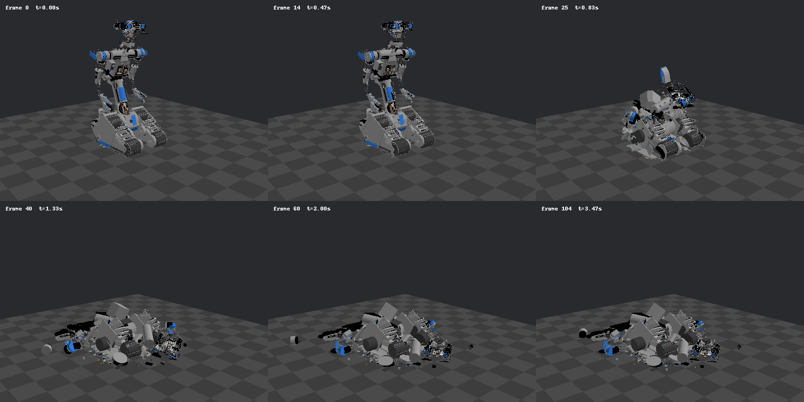

# Fall Apart: baked collapse played from the timeline

## 1. What it is

A display-only effect for the full-body URDF. After a short shudder every body
part falls to the floor as a separate rigid piece; played in reverse the pieces
fly back together. The physics is baked offline, so the editor only replays
poses. Like the tread animation, it adds no URDF joints, drives no hardware and
does not change the servo control list.

## 2. Bake (`bake_fall_apart.py`)

    py -3.10 bake_fall_apart.py               # bake + preview images
    py -3.10 bake_fall_apart.py --no-preview  # bake only

Needs numpy and pybullet. Reads `../johnny5_head.urdf` (never modifies it) and writes
`Meshes/Body/FallApart/fall_apart.json`, `render_fall_apart.png` and
`fall_apart_preview.gif`. The bake is deterministic. Re-run it whenever link names or
zero-pose geometry change; joint limits (such as the hand-closing stops) do not affect it.

| Setting | Value |
| --- | --- |
| Pieces | Every link with visual geometry, except the `head_offset_link` subtree (LED mouth and everything above it), which is one piece. 660 pieces, 701 links. |
| Masses | Per visual: density by material name (metal 2700, rubber 1200, glass 2500, plastic 1150 kg/m³) times the smaller of solid volume and a 3 mm shell. About 63 kg in total; head 2.6 kg. |
| Collision | Convex hull of each piece. Pairs touching at the start ignore each other until they separate, so nothing explodes on frame 0. |
| Timing | 0.5 s shudder (bodies held, jitter growing to 4 mm and 1°), then 3 s of physics at 240 Hz, recorded at 30 fps: 105 frames. |
| Release | Gentle topple: horizontal velocity grows with height, outward from the body axis with a slight forward bias; seeded. |
| Floor | z = -1.0774 m in the `body_root_link` frame (the model's lowest point). |

## 3. Clip format

| Field | Meaning |
| --- | --- |
| `version` | 1 |
| `fps`, `frameCount`, `shudderFrames` | 30, 105, 15 |
| `rootLink`, `floorZ_m` | Frame of all poses; floor height |
| `urdf`, `urdfSha256` | Source model, for information (line endings change the hash, so the editor does not enforce it) |
| `pieces[]` | `name`, `massKg`, `links[]` |
| `links[]` | `link`, `piece`, `poses`: base64 little-endian float32 `[frameCount][px,py,pz,qx,qy,qz,qw]`, the link frame in root-link coordinates. Frame 0 is the zero pose. |

## 4. Editor behaviour

- Timeline command **Fall Apart** (`ServoNames.FallApart`), a URDF-only text command
  whose value is `{"reverse":false,"speed":1}`. API: `insert_fall_apart`.
- The latest enabled command at or before the cursor decides the frame:
  `(cursor - start) x speed x fps`, clamped. Forwards holds the last frame; reverse
  counts down and releases the override at frame 0. Seeking is stateless and exact.
- The clip loads on first use from beside the loaded model. A missing or invalid
  clip makes the effect unavailable without an error.
- Display: while active, every joint node's transform is swapped for a matrix. Nodes
  whose child link is in the clip place it at the interpolated baked pose; frame-only
  links are frozen, so upstream joint motion cannot leak through. Joint positions keep
  updating the detached originals, so releasing restores the live pose exactly.
  During the shudder frames each part blends from its live pose into the clip, so a
  posed robot settles rather than snaps.
- Collision warnings are suppressed while in pieces. Hardware output and exports
  skip the command (`IsUrdfOnly`). Headroom re-timing moves it with other commands.

## 5. Checks

`ServoAnimator.Checks --fall-apart`: command parsing, timeline evaluation
(forwards, reverse, speed, latest command wins, disabled/invalid ignored), blend
weights, matrix/quaternion round trips, API request fields, frame 0 against the
model's zero pose, override accuracy for every link, floor contact, joint motion
ignored while in pieces, and exact restoration on release.
